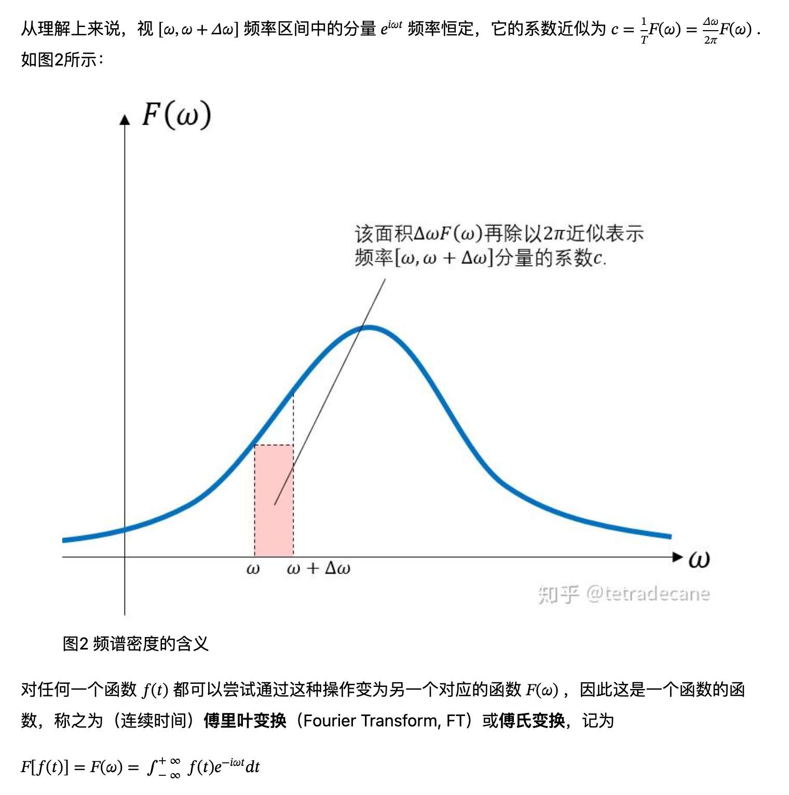

# Zhihu-Scraper

**把值得回看的知乎内容，存进自己的离线档案。**

**简体中文** · [繁體中文](README_ZH_HANT.md) · [English](README_EN.md)

Zhihu-Scraper 是一个知乎本地归档工具。输入文章、回答、问题、专栏或独立视频的链接，默认保存为 **Markdown 和本地媒体**，可按需导出**离线 HTML 和 PDF**，也可以一并保存评论。

[快速开始](#快速开始) · [归档示例](#归档结果) · [使用手册](docs/MANUAL.md)

## 快速开始

支持 Windows、macOS 和 Linux，需要 Git、Python 3.12 或以上版本和 [uv](https://docs.astral.sh/uv/getting-started/installation/)。

```bash
git clone https://github.com/yuchenzhu-research/zhihu-scraper.git
cd zhihu-scraper
uv sync --locked
uv run playwright install chromium
uv run zhihu fetch --html "https://zhuanlan.zhihu.com/p/108271985"
```

完成后，在当前目录的 `知乎归档/` 下打开生成的 HTML 或 Markdown。如果知乎要求登录，请按[登录手册](docs/MANUAL.md#login)配置后重试。全新的 Linux 环境可能还需要浏览器系统依赖。安装脚本、pip 和浏览器设置见[安装与更新](docs/MANUAL.md#install)。

## 支持的知乎链接

| 类型 | 链接示例 | 归档内容 |
| --- | --- | --- |
| 文章 | `zhuanlan.zhihu.com/p/<文章 ID>` | 正文、作者、媒体和所属专栏信息 |
| 单个回答 | `zhihu.com/question/<问题 ID>/answer/<回答 ID>` | 指定回答和相关问题信息 |
| 整个问题 | `zhihu.com/question/<问题 ID>` | 问题和可访问的回答，完整归档时合并成一份文档 |
| 专栏 | `zhihu.com/column/<专栏标识>` | 专栏目录、可访问的文章和篇目导航 |
| 独立视频 | `zhihu.com/zvideo/<视频 ID>` | 视频文件、标题和可获得的描述 |

也支持 `zhihu.com/answer/<回答 ID>`。文章和回答里的知乎视频卡片在媒体可下载时保存视频，否则保留原链接。作者主页、收藏夹、搜索结果、想法、专栏合集和盐选内容暂未支持。

## 归档结果

标题、作者、来源链接、图片、表格、代码块和数学公式会随正文保留。按快速开始的命令归档后，目录类似下面这样，有成功下载的媒体时会生成 `media/`。

```text
知乎归档/
└── 文章标题/
    ├── 文章标题.md
    ├── 文章标题.html
    ├── assets/
    └── media/
        └── 图片文件
```

在浏览器中打开本地 HTML，就能离线查看原文插图和公式。下图截自 tetradecane 的《积分变换（2）——傅里叶变换》的本地 HTML 归档。[知乎原文](https://zhuanlan.zhihu.com/p/108271985)



## 常用操作

| 需要做什么 | 从哪里开始 |
| --- | --- |
| 生成 HTML、PDF，或保存评论 | [选择输出格式与评论](docs/MANUAL.md#commands) |
| 访问需要登录的内容 | [登录并检查会话](docs/MANUAL.md#login) |
| 抓取中断，或者已知分页 offset | [查看进度与继续抓取](docs/MANUAL.md#resume) |
| 修改输出目录、代理或浏览器设置 | [设置文件](docs/MANUAL.md#settings) |
| 遇到访问失败、浏览器或路径报错 | [故障排查](docs/MANUAL.md#troubleshooting) |

问题和专栏会逐项保存进度。对特别长的问题，可以从已知的知乎分页 offset 开始，补抓回答片段。手册说明了两种恢复方式和各自的输出。

## 开发与反馈

- [开发指南](docs/DEVELOPMENT.md) · Python API、本地测试和 CI
- [架构与参考项目](docs/ARCHITECTURE.md) · [功能范围与路线图](docs/FEATURE_TODO.md)
- [报告问题](https://github.com/yuchenzhu-research/zhihu-scraper/issues) · 建议附上版本、运行命令和脱敏后的报错

项目采用 [MIT 许可证](LICENSE)。请仅归档有权访问的内容，并尊重平台规则、版权和隐私。
