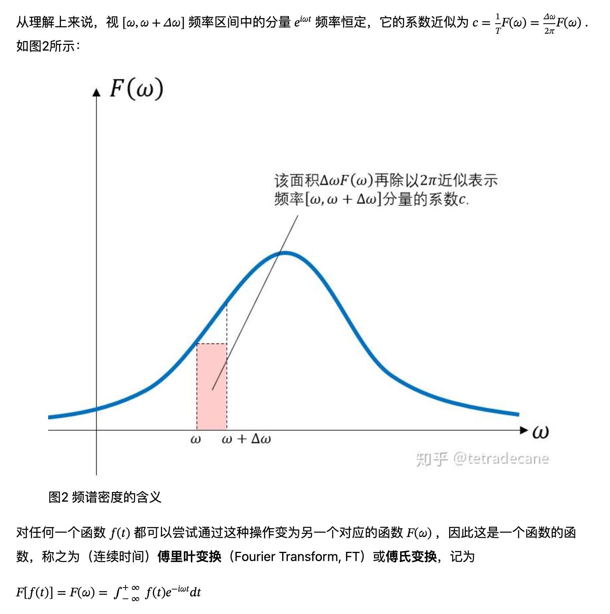

# Zhihu-Scraper

<p align="center">
  <a href="README.md">简体中文</a> · <a href="README_ZH_HANT.md">繁體中文</a> · <strong>English</strong>
</p>

<p align="center"><strong>Save what you see. Record what you think.</strong></p>

Zhihu-Scraper is a local archiving tool for Zhihu. Give it a link to an article, answer, question, column, or standalone video. It saves **Markdown and local media** by default, with optional **offline HTML, PDF, and comments**.

[Quick start](#quick-start) · [Example output](#what-the-archive-looks-like) · [User manual](docs/MANUAL_EN.md)

## Quick start

Runs on Windows, macOS, and Linux. You need Git, Python 3.12 or later, and [uv](https://docs.astral.sh/uv/getting-started/installation/).

```bash
git clone https://github.com/yuchenzhu-research/zhihu-scraper.git
cd zhihu-scraper
uv sync --locked
uv run playwright install chromium
uv run zhihu fetch --html "https://zhuanlan.zhihu.com/p/108271985"
```

Open the generated HTML or Markdown under `知乎归档/` in your current directory. If Zhihu requires sign-in, follow the [sign-in instructions](docs/MANUAL_EN.md#login) and retry. A fresh Linux setup may also need browser system libraries. See [Installation and updates](docs/MANUAL_EN.md#install) for install scripts, pip, and browser setup.

## Supported Zhihu links

| Type | Example link | What gets saved |
| --- | --- | --- |
| Article | `zhuanlan.zhihu.com/p/<article ID>` | Body, author, media, and column information |
| Single answer | `zhihu.com/question/<question ID>/answer/<answer ID>` | The selected answer and its question information |
| Whole question | `zhihu.com/question/<question ID>` | The question and accessible answers, combined in one document after a complete run |
| Column | `zhihu.com/column/<column token>` | An index, accessible articles, and article navigation |
| Standalone video | `zhihu.com/zvideo/<video ID>` | The video file, title, and description when available |

Short answer links such as `zhihu.com/answer/<answer ID>` also work. Embedded Zhihu video cards are saved when the media is downloadable and kept as links otherwise. Author profiles, collections, search results, short posts, column collections, and paid Yanxuan content are currently outside the supported scope.

## What the archive looks like

The archive preserves the title, author, source link, images, tables, code blocks, and formulas alongside the text. The quick start produces the following layout for the example article. The `media/` folder is created when a download succeeds.

```text
知乎归档/
└── Article title/
    ├── Article title.md
    ├── Article title.html
    ├── assets/
    └── media/
        └── image file
```

Open the local HTML file in a browser to see the original illustrations and formulas offline. The preview below shows the local HTML archive of “Integral Transforms (2): The Fourier Transform” by tetradecane. [Original on Zhihu](https://zhuanlan.zhihu.com/p/108271985)



## Common tasks

| I want to… | See the manual |
| --- | --- |
| Export HTML or PDF, or save comments | [Choose output formats and comments](docs/MANUAL_EN.md#commands) |
| Archive content that requires sign-in | [Sign in and check your session](docs/MANUAL_EN.md#login) |
| Recover after an interruption or start at a known offset | [Check progress and resume](docs/MANUAL_EN.md#resume) |
| Change the output directory, proxy, or browser behavior | [Settings file](docs/MANUAL_EN.md#settings) |
| Fix an access, browser, or file path error | [Troubleshooting](docs/MANUAL_EN.md#troubleshooting) |

Question and column archives save progress item by item. For a long question, you can also fetch additional answer fragments from a known Zhihu pagination offset. The manual explains how the two recovery options work and what each one saves.

## Development and feedback

- [Development guide](docs/DEVELOPMENT.md) · Python API, local tests, and CI (Simplified Chinese)
- [Architecture and references](docs/ARCHITECTURE.md) · [Feature scope and roadmap](docs/FEATURE_TODO.md) (Simplified Chinese)
- [Report an issue](https://github.com/yuchenzhu-research/zhihu-scraper/issues) · Include the version, the command you ran, and the error with sensitive information removed

Licensed under the [MIT License](LICENSE). Archive content you have permission to access and respect platform rules, copyright, and privacy.
