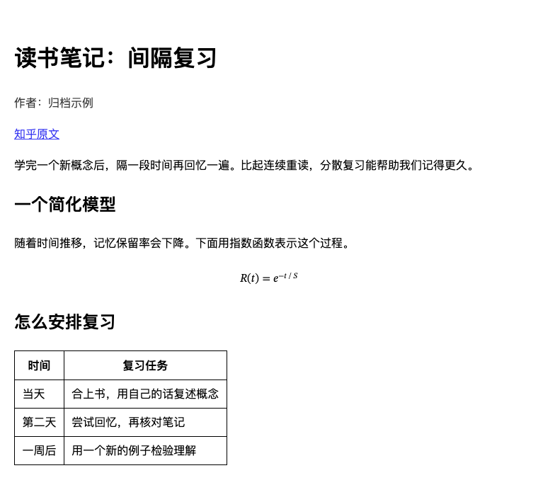

# Zhihu-Scraper

**把值得回看的知乎內容，存進自己的離線檔案。**

[简体中文](README.md) · **繁體中文** · [English](README_EN.md)

Zhihu-Scraper 是一款知乎本機封存工具。輸入文章、回答、問題、專欄或獨立影片的連結，預設儲存為 **Markdown 和本機媒體檔案**，也能視需要匯出**離線 HTML 和 PDF**，或一併儲存留言。

[快速開始](#快速開始) · [封存範例](#封存結果) · [使用手冊](docs/MANUAL_ZH_HANT.md)

## 快速開始

支援 Windows、macOS 和 Linux，需要 Git、Python 3.12 或以上版本，以及 [uv](https://docs.astral.sh/uv/getting-started/installation/)。

```bash
git clone https://github.com/yuchenzhu-research/zhihu-scraper.git
cd zhihu-scraper
uv sync --locked
uv run playwright install chromium
uv run zhihu fetch "https://zhuanlan.zhihu.com/p/357892158"
```

完成後，在目前目錄的 `知乎归档/` 下開啟產生的 Markdown。全新的 Linux 環境可能還需要瀏覽器的系統相依套件。安裝指令碼、pip 和瀏覽器設定請見[安裝與更新](docs/MANUAL_ZH_HANT.md#install)。

## 支援的知乎連結

| 類型 | 連結範例 | 封存內容 |
| --- | --- | --- |
| 文章 | `zhuanlan.zhihu.com/p/<文章 ID>` | 內文、作者、媒體和所屬專欄資訊 |
| 單一回答 | `zhihu.com/question/<問題 ID>/answer/<回答 ID>` | 指定的回答和相關問題資訊 |
| 整個問題 | `zhihu.com/question/<問題 ID>` | 問題和可存取的回答，完整封存時合併為一份文件 |
| 專欄 | `zhihu.com/column/<專欄識別碼>` | 專欄目錄、可存取的文章和篇目導覽 |
| 獨立影片 | `zhihu.com/zvideo/<影片 ID>` | 影片檔案、標題和可取得的說明 |

也支援 `zhihu.com/answer/<回答 ID>`。文章和回答裡的知乎影片卡片會在媒體可下載時儲存影片，否則保留原連結。目前尚未支援作者頁面、收藏夾、搜尋結果、想法、專欄合集和鹽選內容。

## 封存結果

標題、作者、來源連結、圖片、表格、程式碼區塊和數學公式會隨內文保留。單篇文章的預設封存結構如下，成功下載媒體時會建立 `media/`。

```text
知乎归档/
└── 文章標題/
    ├── 文章標題.md
    └── media/
        └── 圖片檔案
```

啟用 HTML 後可以用瀏覽器離線閱讀，也會保留表格和公式。下圖是工具使用示範內容實際產生的 HTML。



## 常用操作

| 想做什麼 | 從哪裡開始 |
| --- | --- |
| 產生 HTML、PDF，或儲存留言 | [選擇輸出格式與留言](docs/MANUAL_ZH_HANT.md#commands) |
| 存取需要登入的內容 | [登入並檢查工作階段](docs/MANUAL_ZH_HANT.md#login) |
| 擷取中斷，或已知分頁 offset | [查看進度與繼續擷取](docs/MANUAL_ZH_HANT.md#resume) |
| 修改輸出目錄、代理伺服器或瀏覽器設定 | [設定檔](docs/MANUAL_ZH_HANT.md#settings) |
| 遇到存取失敗、瀏覽器或路徑錯誤 | [疑難排解](docs/MANUAL_ZH_HANT.md#troubleshooting) |

問題和專欄會逐項儲存進度。遇到回答特別多的問題，可以從已知的知乎分頁 offset 開始，補抓回答片段。手冊說明了兩種恢復方式及其輸出。

## 開發與回饋

- [開發指南](docs/DEVELOPMENT.md) · Python API、本機測試和 CI（簡體中文）
- [架構與參考專案](docs/ARCHITECTURE.md) · [功能範圍與規劃](docs/FEATURE_TODO.md)（簡體中文）
- [回報問題](https://github.com/yuchenzhu-research/zhihu-scraper/issues) · 建議附上版本、執行指令，以及移除敏感資訊後的錯誤訊息

本專案採用 [MIT 授權](LICENSE)。請只封存有權存取的內容，並尊重平台規則、著作權和隱私。
